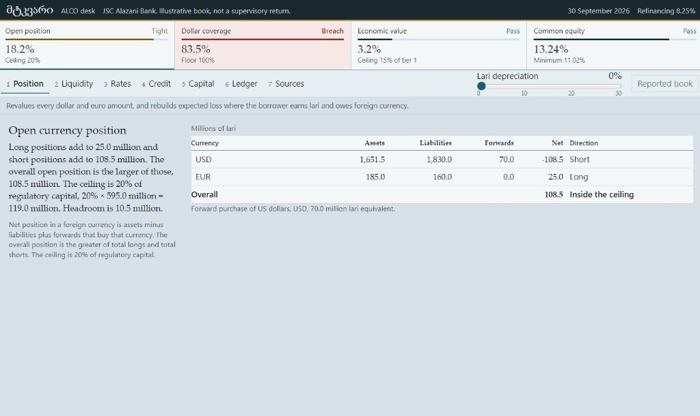

# მტკვარი

Made for Georgian banks. It is the desk I wanted for the limits a treasurer actually sits with: the open currency position, liquidity, the rate shock, expected credit loss, and capital.

The bank in the window is JSC Alazani Bank. I made the book up. It is not a filing to the National Bank, and nothing in here moves money.



That shot is the reported book. Dollar coverage is already through the floor, at 83.5%. The open position is 18.2%, still inside the 20% ceiling. Common equity is 13.24%. The lari slider is the whole trick: pull it and the foreign-currency book is revalued, then expected loss is rebuilt for borrowers who earn lari and owe dollars or euros.

## Run it

```text
npm install
npm test
npm run app
```

`npm run app` opens the window. Keys 1 to 7 switch sheets. Reported book puts the slider back to zero.

## Where the numbers come from

The 20% open-position ceiling is National Bank Order No. 201 of 20 July 2006. The 15% ceiling on the loss of economic value is Order No. 42/04 of 12 March 2020. Pillar 1 is 4.5%, 6% and 8%. The conservation buffer is 2.5%. The countercyclical buffer in this book is 0.75%, the step that was due on 15 March 2026, on the way to 1% on 15 March 2027. Since 1 August 2025, a loan of up to 750,000 lari to someone paid in lari has to be made in lari.

The refinancing rate is 8.25%. That is where the National Bank left it on 9 September 2026.

A few rates are mine, and the screen says so. The lari liquidity floor of 75% is the split from the IMF assessment in 2021, not a template I pulled off the current instruction. Runoff rates sit on each ledger line. Lari rate shocks are the dollar Basel sizes, because the order points to scenario sizes published on their own. I assumed a 0.5% systemic buffer, 2% for Pillar 2, and a 50% extra risk weight on unhedged foreign-currency exposure. Dollar and euro curves are flat. The link from debt service to default probability is a logistic with a slope I picked so the tape moves. It is not a validated credit model.
